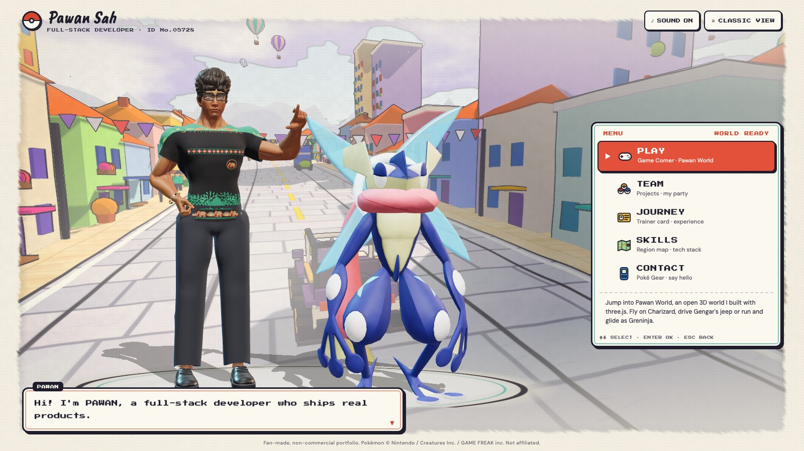
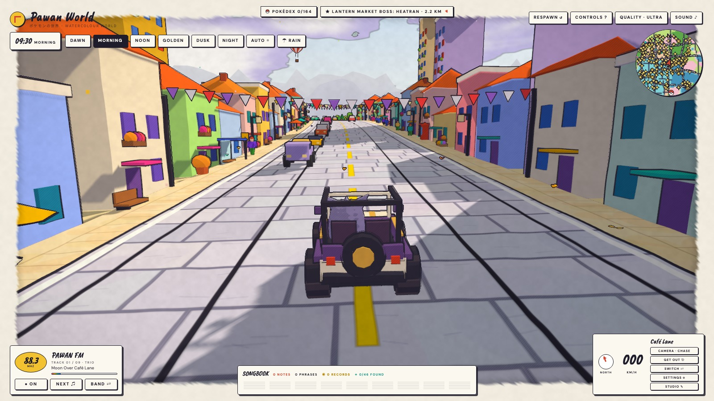
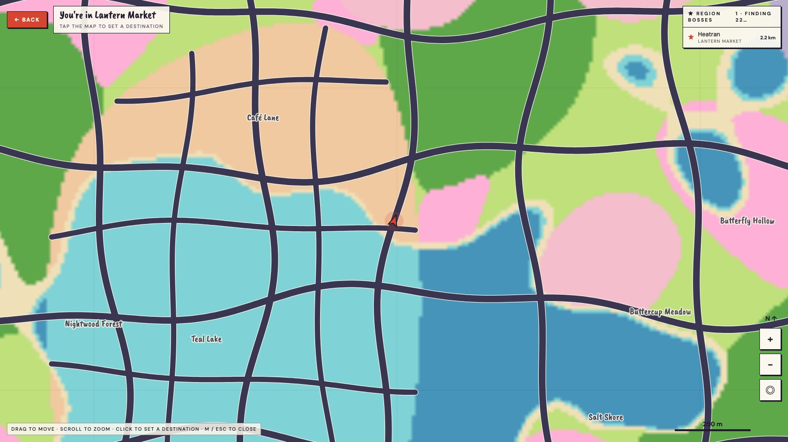
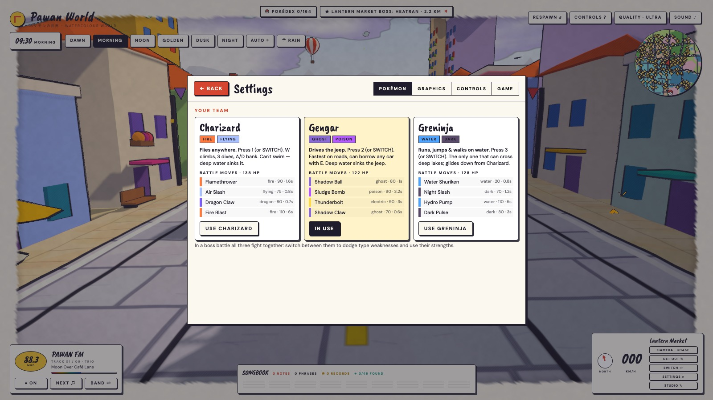
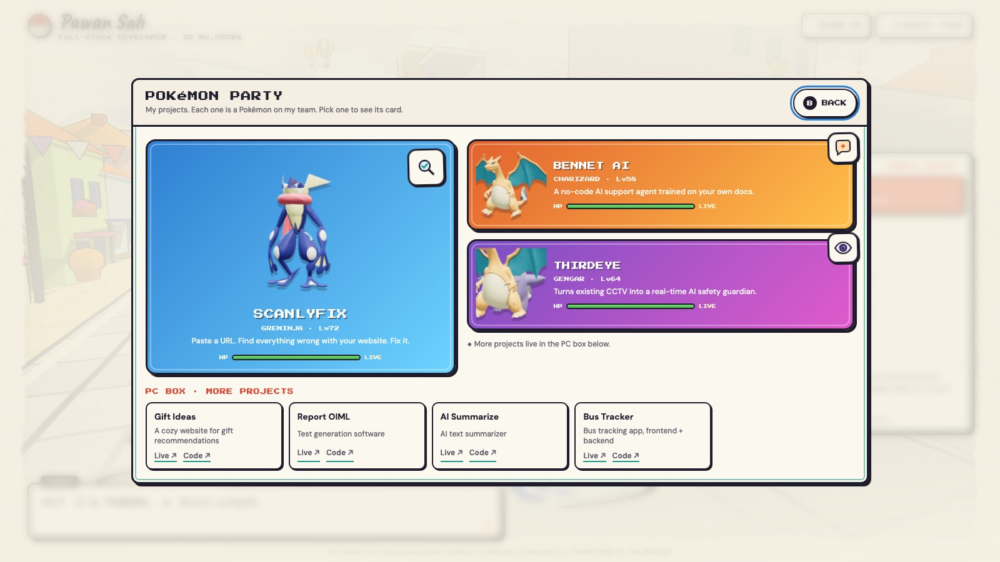

<p align="center">
  
</p>

<h1 align="center">Pawan World</h1>

<p align="center">
  <strong>An open-world Pokémon fan game — and an interactive developer portfolio.</strong><br />
  Ride Charizard, drive Gengar's jeep and glide as Greninja through a hand-painted watercolour world.
</p>

<p align="center">
  <a href="https://pawan-portfolio-silk-mu.vercel.app/">
    
  </a>
  <a href="https://github.com/Pawan-webdeveloper/MyPortfolio/stargazers">
    
  </a>
</p>

<p align="center">
  
  
  
  
  
  <a href="LICENSE"></a>
  <a href="https://github.com/Pawan-webdeveloper/MyPortfolio/actions/workflows/ci.yml"></a>
</p>

<p align="center">
  <a href="https://pawan-portfolio-silk-mu.vercel.app/">
    
  </a>
</p>

<p align="center">
  <a href="#about">About</a> ·
  <a href="#features">Features</a> ·
  <a href="#screenshots">Screenshots</a> ·
  <a href="#controls">Controls</a> ·
  <a href="#tech-stack">Tech stack</a> ·
  <a href="#run-locally">Run locally</a> ·
  <a href="#license">License</a>
</p>

---

## About

**Pawan World** is a browser-based, open-world Pokémon fan game that doubles as my developer portfolio. It is built with **three.js**, **vanilla JavaScript**, and **no build step** — open the page and play.

The world streams in as you travel: painted roads, patchwork fields, deep forests, lakes, cherry groves and mountain passes. Each of the **32 regions** has its own wild Pokémon roster and a legendary boss waiting in a lair. Back at the start menu, the same world becomes a portfolio: **PLAY**, **TEAM** (projects), **JOURNEY** (experience), **SKILLS**, **CONTACT**, and a plain **CLASSIC VIEW** for visitors in a hurry.

It is a personal project, a Pokémon tribute, and a playground for WebGL, procedural generation, shader work and game-feel experiments.

### At a glance

- **32 regions**, **164 wild Pokémon** from generations 1–7, and **32 legendary bosses** — one per region.
- **Three playable Pokémon**, each with a different way to move: Charizard flies, Gengar drives, Greninja runs, glides and crosses deep water.
- **Real Pokémon-style battles**: four moves per Pokémon, type effectiveness, STAB, crits, telegraphed attacks, dodging and hard-mode boss AI.
- **100% client-side** — no backend, no account, no tracking.
- **Installable PWA** with an offline cache and mobile touch controls.
- **32 automated tests** covering the roster, battle math, world-map routing and the Greninja glide state machine.

## Features

### A portfolio inside the game

The start menu is the portfolio. Pick a section and the world reacts.

| Menu | What it shows |
| --- | --- |
| **PLAY** | Starts the game and hands control to the 3D world. Unlocks once the world has finished building. |
| **TEAM** | Projects as a Pokémon party — pick one to open a card with its description, role, tech-stack "types", features as "moves", architecture and links. A PC box lists smaller projects. |
| **JOURNEY** | A trainer card and experience chapters. |
| **SKILLS** | A top-down pixel-art region with five skill towns, walkable with arrows/WASD or tap-to-walk. |
| **CONTACT** | A Poké Gear screen with email, LinkedIn, GitHub, website and a message form. |
| **CLASSIC VIEW** | Everything on one plain page for visitors in a hurry. |

The portfolio content lives in [`home/content.js`](home/content.js); the 3D duo and menu live in [`home/`](home/).

### An endless watercolour world

- Procedural terrain streams in chunks, so the world keeps going in every direction.
- Hand-drawn outlines, watercolour shading, canvas grain and a torn frame give the game its painted look.
- Painted roads double as sheet music: steer through floating notes to play each road's melody.
- Day and night cycle, rain, a fully generative lo-fi radio, photo mode and a studio mode that hides the HUD.

### Three ways to travel

- **Charizard** — fly over anything, climb and dive, and land wherever you like.
- **Gengar** — drive a jeep, park it, get out, and borrow any car, bus or tractor you find.
- **Greninja** — run, jump, glide and cross deep water on the surface, with Ash-inspired details during the glide and landing.

Press **E** to switch between riding and walking, and **Switch** to cycle Pokémon.

### 164 wild Pokémon

- Every region has its own roster: city Pokémon and pets in towns, farm animals in fields, Bug/Grass/Dark types in forests, Fairy/Grass types in meadows and groves, Rock/Ground/Ice/Steel in the mountains, and Water types in lakes.
- Herds, flocks and solitary species react to you — timid Pokémon run, curious ones come closer, and **E** greets the nearest one on foot.
- First sightings fill the Pokédex, saved in `localStorage`.
- Models are baked, simplified, texture-compressed and Draco-compressed, then drawn with GPU instancing. Legs, wings and hops are animated in the vertex shader, so 164 species stay light on performance.

### Legendary boss battles

- Every region has one legendary boss with a fixed lair, a gold ring, a minimap marker and a tracker chip.
- Walk up and press **E** to open a Challenge card, then fight with your three Pokémon against the boss.
- Each Pokémon has four real moves with types, powers and cooldowns; the boss uses a signature move plus three moves of its types.
- Every attack is telegraphed in red on the ground. Roll with **Space** to dodge through attacks, switch party members with **Q / Tab**, and use the type chart to resist the boss's moves.
- Bosses sidestep attacks they see coming, chain attacks, and enrage below half health. Win and the boss leaves for good; lose and your team is healed for another try.

### World map and navigation

Press **M** or tap the minimap for a full-screen map. Drop a pin, pick a boss and hit **Navigate**; the shortest route is drawn on the map and minimap, a chip points the way, and a beacon marks the spot. Routes prefer roads, avoid town blocks and forests, and keep the jeep out of deep water. Greninja can cross water; Charizard flies straight.

### Settings, mobile and offline

- **Settings** covers graphics quality, rain, time of day, minimap, key bindings and progress (Pokédex, bosses defeated, reset).
- Phones play in landscape with a joystick, six touch buttons and tap-to-walk menus.
- The web manifest makes the game installable; the service worker caches the page, models, decoder and home-screen code for offline play after the first load.

## Screenshots

| Start menu | Open world |
| --- | --- |
|  |  |

| World map | Settings and guide |
| --- | --- |
|  |  |

<p align="center">
  
  <br />
  <em>TEAM — projects as a Pokémon party, with a PC box for smaller projects.</em>
</p>

## Controls

| Key | Action |
| --- | --- |
| 1 / 2 / 3 | Charizard / Gengar's jeep / Greninja |
| W / S | Throttle / brake, or walk forward / back |
| A / D | Steer |
| Space | Hop / jump |
| Shift | Boost / run |
| E | Get in / out of a vehicle · on foot: greet a Pokémon, challenge a boss |
| F / G | Glider / eagle flight (press again to land) |
| Esc | Settings and guide |
| C | Cycle camera |
| Scroll, + / − | Zoom |
| [ / ] | Adjust field of view |
| K | Toggle rain |
| R / N / B | Radio on/off / next song / band |
| M | World map (or click / tap the minimap) |
| P | Photo |
| H | Hide UI |
| Drag | Look around |

**Boss battles:** WASD to move, **Space** to dodge, **1–4** for moves, **Q / Tab** to switch Pokémon, **Esc** twice to run.

**Touch:** landscape orientation; the joystick and six on-screen buttons provide camera, Switch, settings, get in/out, boost and hop controls.

## Tech stack

| Layer | Technology |
| --- | --- |
| Rendering | **three.js r170** via import map, custom GLSL for outlines, watercolour shading, canvas grain and the vignette |
| Language | **Vanilla JavaScript** ES modules, HTML5, CSS3 — no framework, no bundler |
| World | Seeded procedural terrain, chunk streaming, painted roads, instanced props |
| Pokémon | glTF/GLB models, Draco compression, GPU instancing, vertex-shader locomotion |
| Audio | **Web Audio API** — generative radio, engine, weather and battle SFX |
| Offline | Service Worker + Web App Manifest |
| Tests | Node.js **`node:test`** |
| Hosting | **Vercel** static deployment from `main` |

## Project structure

```text
.
├── index.html              # game shell, renderer, world, audio and UI
├── hero.js                 # home-screen trainer model
├── home/                   # portfolio menu, sections, 3D stage and content
├── wild/                   # wild Pokémon, Pokédex, battle math and boss arena
├── nav/                    # world map and route planner
├── ui/                     # settings and guide panel
├── models/                 # optimized glTF/GLB Pokémon and trainer models
├── icons/                  # PWA icons
├── tests/                  # node:test regression suites
├── tools/                  # optional asset pipeline and preview pages
├── vendor/                 # Draco decoder
├── docs/screenshots/       # README images
├── manifest.webmanifest    # PWA manifest
├── sw.js                   # service worker
├── LICENSE                 # MIT license for the source code
├── NOTICE.md               # third-party asset and library notices
└── package.json            # test script and project metadata
```

## Run locally

There is no build step and nothing to install just to play.

```bash
git clone https://github.com/Pawan-webdeveloper/MyPortfolio.git
cd MyPortfolio
python3 -m http.server 8437
```

Open <http://localhost:8437>. On phones, use landscape orientation.

### Optional: rebuild the Pokémon models

The asset pipeline is only needed if you change the wild roster. It requires the
dev dependencies in [`tools/package.json`](tools/package.json):

```bash
npm install --prefix tools
node tools/build-wild.mjs
```

Preview pages live in `tools/` (`wild-preview.html`, `stage-preview.html`,
`hero-preview.html`, `trainer-preview.html`).

## Tests

```bash
node --test
```

The suite covers:

- every region having a roster in the right biome;
- unique bosses and species across all 32 regions;
- habitat types checked against PokéAPI data;
- generations 1–7 only, with bosses spread across all generations;
- boss-battle type math and move data;
- world-map routing around deep water;
- Greninja's glide and landing state machine;
- deep-water behaviour for the jeep, Charizard and Greninja.

CI runs the same tests plus a syntax check of every browser module on each push
and pull request.

## Deployment

The game is deployed on **Vercel**:

**https://pawan-portfolio-silk-mu.vercel.app/**

Vercel builds and deploys the `main` branch. Because the project is static,
there is no server, database or environment variable to configure.

## Contributing

Issues and pull requests are welcome. Read [`CONTRIBUTING.md`](CONTRIBUTING.md)
for the local setup, the test command and the asset rules. Please keep the
project client-side and do not add copyrighted Pokémon assets.

## License

The source code in this repository is released under the [MIT License](LICENSE).

**Pawan World is an unofficial, non-commercial Pokémon fan project.** Pokémon
names, characters, artwork and 3D models are the property of Nintendo /
Creatures Inc. / GAME FREAK inc. and are **not** covered by the MIT license.
The project is not affiliated with or endorsed by those companies.

Third-party asset and library credits — including the Pokémon model source,
PokéAPI, three.js, Draco, Google Fonts and the CC0 trainer base body — are
listed in [`NOTICE.md`](NOTICE.md).

## Author

**Pawan Sah** — Full-stack developer based in Faridabad, India.

- GitHub: [@Pawan-webdeveloper](https://github.com/Pawan-webdeveloper)
- LinkedIn: [pawan-sah](https://www.linkedin.com/in/pawan-sah-661a86327/)
- Live game and portfolio: [pawan-portfolio-silk-mu.vercel.app](https://pawan-portfolio-silk-mu.vercel.app/)
- Email: [pawan572893@gmail.com](mailto:pawan572893@gmail.com)

If you enjoy the project, a star on the repository is appreciated.

---

**Topics:** `#pokemon` `#threejs` `#webgl` `#gamedev` `#indiegame` `#javascript` `#html5` `#pwa` `#portfolio` `#creativecoding` `#fanmade` `#opensource`
